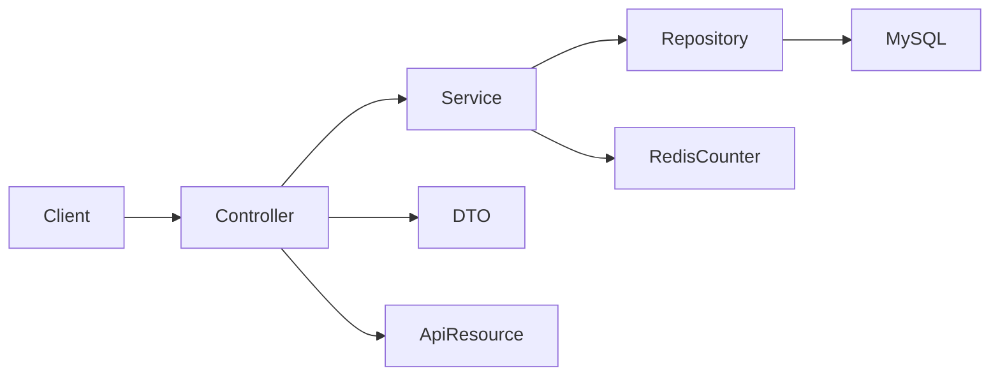
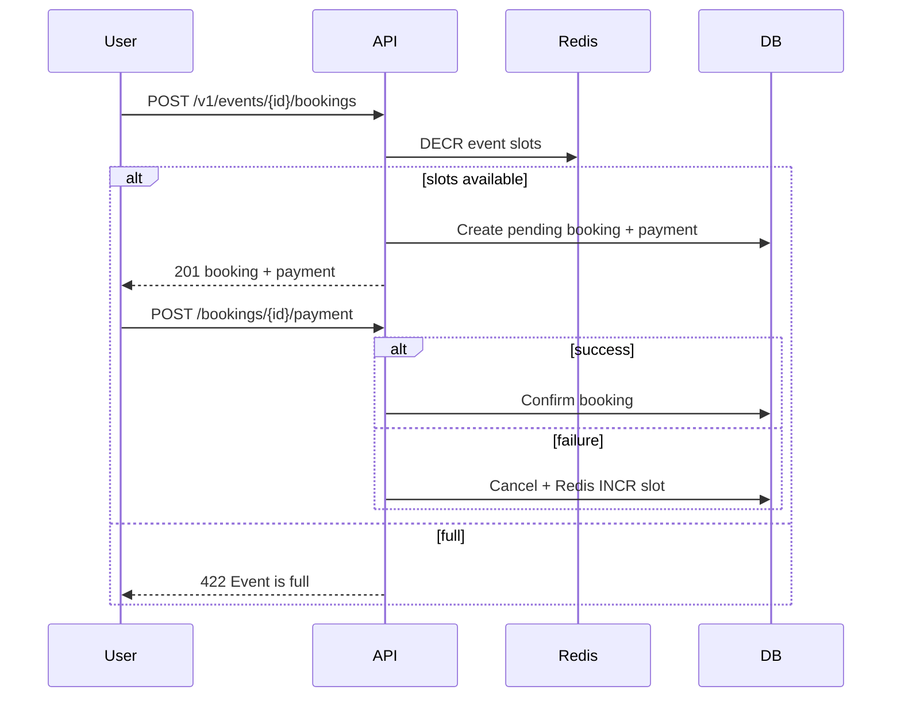

# HeroTech Event Booking API — Technical Interview Project

A high-concurrency event booking system built with Laravel 13, MySQL, Redis, and Sanctum.

This repository is a **technical interview project** designed to evaluate whether a developer can read, extend, and reason about a complex Laravel system — covering concurrency control, layered architecture, test-driven development, and API design.

**Author:** Morteza Karimi — [me@morteza-karimi.com](mailto:me@morteza-karimi.com)

---

## Tech Stack

| Layer | Choice |
|-------|--------|
| Framework | Laravel 13, PHP 8.5 |
| Database | MySQL 8.4 (InnoDB) |
| Cache / concurrency | Redis (atomic slot counters) |
| Auth | Laravel Sanctum (Bearer tokens) |
| API docs | L5-Swagger (OpenAPI 3) |
| Tests | Pest PHP |
| Load testing | k6 ([`tests/Performance/booking_stress.js`](tests/Performance/booking_stress.js)) |
| Dev environment | Laravel Sail (Docker) |

---

## Chosen Architecture

The system follows a deliberate layered design defined in [`AGENTS.md`](AGENTS.md):



- **Service-Repository pattern** — Controllers stay thin; business logic lives in [`app/Services/`](app/Services/), data access in [`app/Repositories/`](app/Repositories/).
- **DTOs** — Strongly typed data transfer objects in [`app/DTOs/`](app/DTOs/) replace loose arrays between layers.
- **API versioning** — All routes are under `/api/v1` ([`routes/api.php`](routes/api.php)).
- **Concurrency strategy** — Redis atomic `DECR` on `event:{id}:slots` before DB writes; pessimistic locking inside transactions; unique `active_key` on bookings enforces one active booking per user per event.
- **Payment simulation** — Bookings start as `pending` and require payment confirmation; failed or expired payments release slots back to Redis.

---

## Project Structure

```
app/
├── DTOs/           # Typed request/filter objects
├── Enums/          # BookingStatus, UserRole, PaymentStatus, etc.
├── Http/
│   ├── Controllers/V1/
│   ├── Requests/
│   └── Resources/
├── Jobs/           # ExpirePaymentJob
├── Models/
├── Repositories/   # + Contracts/
└── Services/       # Booking, Event, Payment + Redis slot counter

database/           # migrations, factories, seeders
routes/api.php      # versioned API routes
tests/
├── Feature/V1/     # Auth, Events, Bookings (incl. concurrency test)
└── Performance/    # k6 stress script

AGENTS.md           # Architecture spec + Laravel Boost agent rules
.cursor/skills/     # Agent skills (Pest, Laravel best practices)
.agents/skills/     # TDD workflow skills
```

---

## Getting Started with Laravel Sail

### Prerequisites

- [Docker Desktop](https://www.docker.com/products/docker-desktop/)
- [Composer](https://getcomposer.org/)

### Setup

```bash
# Clone and install dependencies
composer install
cp .env.example .env
```

Update `.env` for Sail (key values):

```dotenv
DB_HOST=mysql
DB_DATABASE=hero_tech_technical_test
REDIS_HOST=redis
QUEUE_CONNECTION=redis
CACHE_STORE=redis
```

```bash
# Start containers
./vendor/bin/sail up -d

# Application setup
./vendor/bin/sail artisan key:generate
./vendor/bin/sail artisan migrate --seed
./vendor/bin/sail artisan l5-swagger:generate
```

- **App URL:** `http://localhost` (port from `APP_PORT`, default `80`)
- **Docker services:** `laravel.test`, `mysql`, `redis`
- **Optional alias:** `alias sail='./vendor/bin/sail'`

### Without Sail

If running PHP locally, ensure MySQL and Redis are available and set `DB_HOST=127.0.0.1` instead of `mysql`. All other commands use `php artisan` instead of `./vendor/bin/sail artisan`.

---

## Working with the Project

| Task | Command |
|------|---------|
| Run tests | `./vendor/bin/sail test` or `composer test` |
| Run a single test | `./vendor/bin/sail artisan test --filter=ConcurrentBooking` |
| Format PHP | `vendor/bin/pint --dirty` |
| Seed users | `./vendor/bin/sail artisan db:seed` |
| Queue worker | `./vendor/bin/sail artisan queue:work` |
| k6 load test | `k6 run tests/Performance/booking_stress.js -e BASE_URL=http://localhost` |

### Seeded Accounts

| Email | Role | Password |
|-------|------|----------|
| `admin@example.com` | admin | `password` |
| `user@example.com` | user | `password` |

---

## Swagger API Documentation

Interactive API docs are served by [L5-Swagger](https://github.com/DarkaOnLine/L5-Swagger).

| Item | Value |
|------|-------|
| UI URL | `http://localhost/api/docs` |
| Regenerate spec | `./vendor/bin/sail artisan l5-swagger:generate` |
| Output file | `storage/api-docs/api-docs.json` |

**Using Swagger:**

1. Open `http://localhost/api/docs` in your browser.
2. Call `POST /api/v1/login` or `POST /api/v1/register` to obtain a token.
3. Click **Authorize** and enter `Bearer {your_token}`.
4. Explore and test protected endpoints directly from the UI.

OpenAPI annotations are defined on controllers, models, and requests under [`app/`](app/).

---

## User Types

Roles are defined in [`app/Enums/UserRole.php`](app/Enums/UserRole.php):

| Role | Value | Purpose |
|------|-------|---------|
| **User** | `user` | Default role on register; can book events and manage own bookings |
| **Admin** | `admin` | Reserved role with `EnsureUserIsAdmin` middleware; not enforced on event routes today (events are public CRUD) |

### Authentication Flow

1. `POST /api/v1/register` or `POST /api/v1/login` → receive a Sanctum Bearer token.
2. Send `Authorization: Bearer {token}` on all protected routes.
3. `GET /api/v1/me` returns the authenticated user.
4. `POST /api/v1/logout` revokes the current token.

Register and login are throttled at 6 requests per minute.

---

## Application Flow

### Events (public)

Event listing, creation, retrieval, update, and deletion are available without authentication.

### Booking Lifecycle (authenticated)



### Business Rules

- One active booking per user per event (enforced by a unique `active_key` database constraint).
- Booking statuses: `pending` → `confirmed` or `cancelled`.
- Cancellation releases the Redis slot and restores `available_slots` if the booking was confirmed.
- Payment expiry is handled asynchronously via `ExpirePaymentJob`.

### API Endpoints

All routes are prefixed with `/api/v1`.

**Auth**

| Method | Endpoint | Auth |
|--------|----------|------|
| POST | `/register` | Public |
| POST | `/login` | Public |
| POST | `/logout` | Sanctum |
| GET | `/me` | Sanctum |

**Events**

| Method | Endpoint | Auth |
|--------|----------|------|
| GET | `/events` | Public |
| POST | `/events` | Public |
| GET | `/events/{event}` | Public |
| PUT | `/events/{event}` | Public |
| DELETE | `/events/{event}` | Public |

**Bookings**

| Method | Endpoint | Auth |
|--------|----------|------|
| GET | `/bookings` | Sanctum |
| GET | `/bookings/{booking}` | Sanctum |
| POST | `/events/{event}/bookings` | Sanctum |
| POST | `/bookings/{booking}/payment` | Sanctum |
| POST | `/bookings/{booking}/confirm` | Sanctum |
| DELETE | `/bookings/{booking}` | Sanctum |

---

## Agentic Development

This project is structured to work well with AI coding agents (Cursor, Claude Code, GitHub Copilot, etc.).

### AGENTS.md

[`AGENTS.md`](AGENTS.md) contains the full system design specification — concurrency strategy, TDD requirements, schema constraints — plus [Laravel Boost](https://laravel.com/docs/ai) guidelines that agents should follow when modifying code.

### Laravel Boost

Laravel Boost provides MCP tools for schema inspection, documentation search, log reading, and more. Configuration lives in [`.cursor/mcp.json`](.cursor/mcp.json).

To install Boost on a fresh clone:

```bash
composer require laravel/boost --dev
php artisan boost:install
```

### Agent Skills

| Path | Purpose |
|------|---------|
| [`.agents/skills/tdd/`](.agents/skills/tdd/) | Red-green-refactor TDD workflow |
| [`.agents/skills/laravel-tdd/`](.agents/skills/laravel-tdd/) | Laravel/Pest testing patterns |
| [`.cursor/skills/laravel-best-practices/`](.cursor/skills/laravel-best-practices/) | Laravel coding conventions |
| [`.cursor/skills/pest-testing/`](.cursor/skills/pest-testing/) | Pest-specific testing guidance |

---

## Credits

- **Morteza Karimi** — Author; built for the HeroTech back-end developer technical interview
- [Laravel](https://laravel.com) — Taylor Otwell and contributors
- [Laravel Sanctum](https://laravel.com/docs/sanctum), [L5-Swagger](https://github.com/DarkaOnLine/L5-Swagger), [Pest PHP](https://pestphp.com/), [Laravel Sail](https://laravel.com/docs/sail), [Laravel Boost](https://laravel.com/docs/ai)

---

## License

This project is open-sourced software licensed under the [MIT License](https://opensource.org/licenses/MIT).

```
MIT License

Copyright (c) 2026 Morteza Karimi

Permission is hereby granted, free of charge, to any person obtaining a copy
of this software and associated documentation files (the "Software"), to deal
in the Software without restriction, including without limitation the rights
to use, copy, modify, merge, publish, distribute, sublicense, and/or sell
copies of the Software, and to permit persons to whom the Software is
furnished to do so, subject to the following conditions:

The above copyright notice and this permission notice shall be included in all
copies or substantial portions of the Software.

THE SOFTWARE IS PROVIDED "AS IS", WITHOUT WARRANTY OF ANY KIND, EXPRESS OR
IMPLIED, INCLUDING BUT NOT LIMITED TO THE WARRANTIES OF MERCHANTABILITY,
FITNESS FOR A PARTICULAR PURPOSE AND NONINFRINGEMENT. IN NO EVENT SHALL THE
AUTHORS OR COPYRIGHT HOLDERS BE LIABLE FOR ANY CLAIM, DAMAGES OR OTHER
LIABILITY, WHETHER IN AN ACTION OF CONTRACT, TORT OR OTHERWISE, ARISING FROM,
OUT OF OR IN CONNECTION WITH THE SOFTWARE OR THE USE OR OTHER DEALINGS IN THE
SOFTWARE.
```
